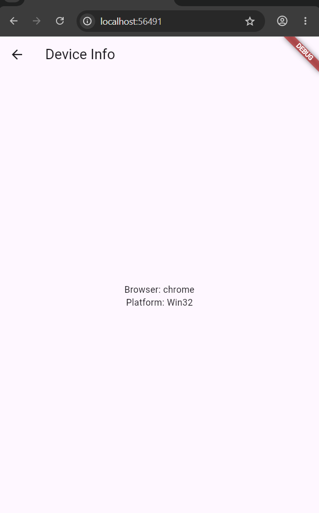
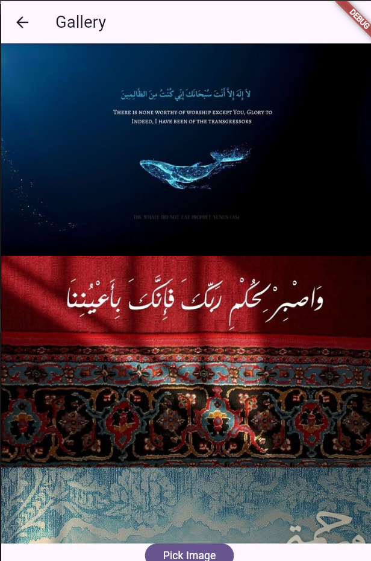
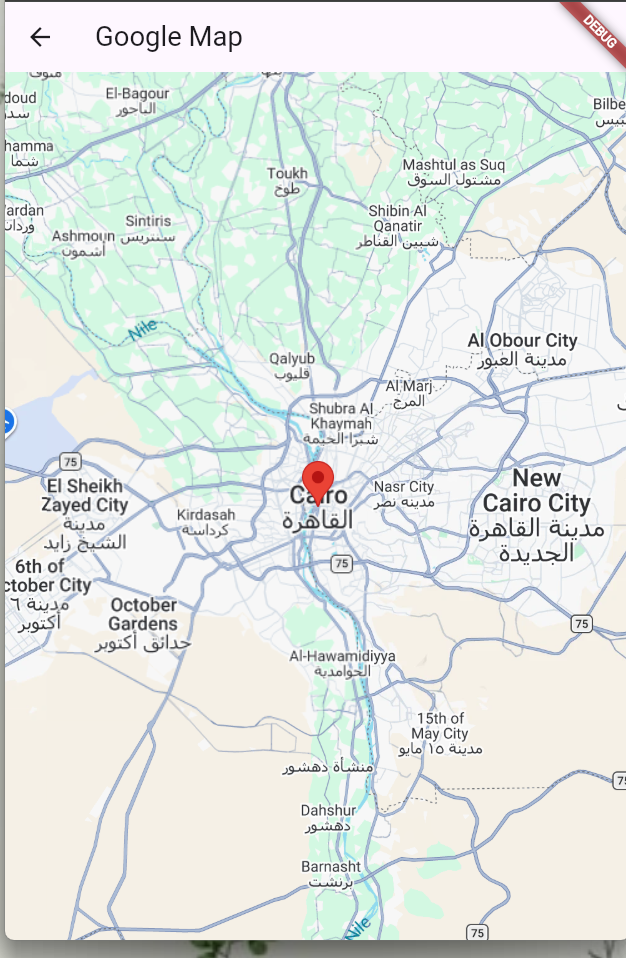
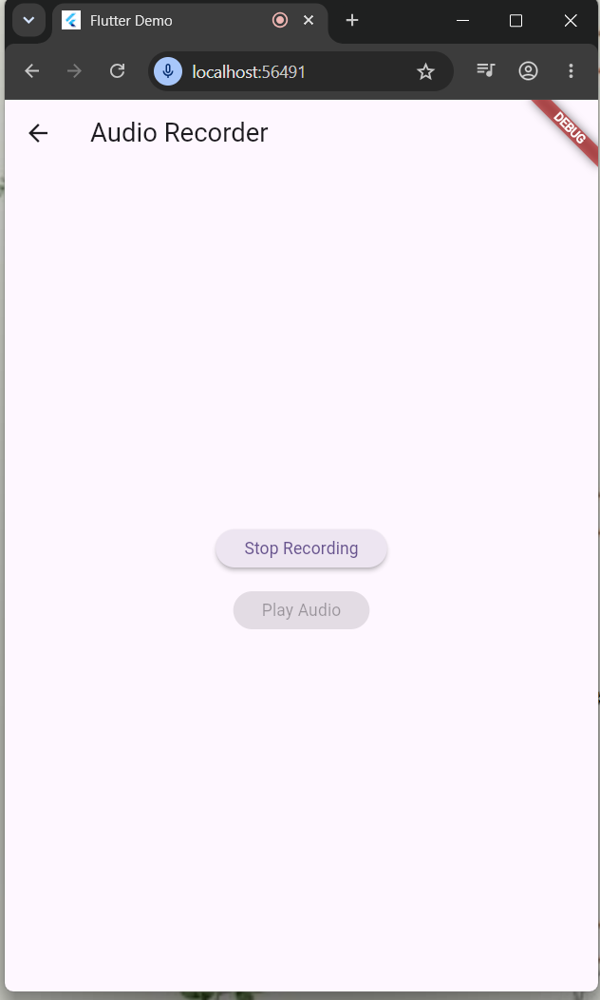

# Device Features Mini Project

A Flutter app that integrates native device features, one phase at a time.

## Features

| Phase | Feature | Package |
|---|---|---|
| 1 | Device model and OS version | `device_info_plus` |
| 2 | Pick multiple images into a gallery list | `image_picker` |
| 3 | Google Map with a red marker on Cairo | `google_maps_flutter` |
| 5 | Record and play back audio | `record`, `audioplayers`, `path_provider` |

## Permissions

| Phase | Android | iOS |
|---|---|---|
| 1 | None | None |
| 2 | None (system Photo Picker) | `NSPhotoLibraryUsageDescription` |
| 3 | `INTERNET` + Google Maps API key (`com.google.android.geo.API_KEY` meta-data) | API key in `AppDelegate` (if used) |
| 5 | `RECORD_AUDIO` | `NSMicrophoneUsageDescription` |

On web, the browser asks for microphone access when recording starts (requires HTTPS or localhost).

## Google Maps API Key

The key is not included in this repository. Add your own key in
`android/app/src/main/AndroidManifest.xml`:

    <meta-data
        android:name="com.google.android.geo.API_KEY"
        android:value="YOUR_API_KEY"/>

## Project Structure

    lib/
      screens/   home, device info, gallery, map, audio
      widgets/   phase button, picked image tile
      services/  device info, image picker, audio

## Screenshots

| Device Info | Gallery |
|---|---|
|  |  |

| Google Map | Audio |
|---|---|
|  |  |

## Demo Video

[Watch the demo](https://youtu.be/IhuLNEmurIg)

## Run

    flutter pub get
    flutter run